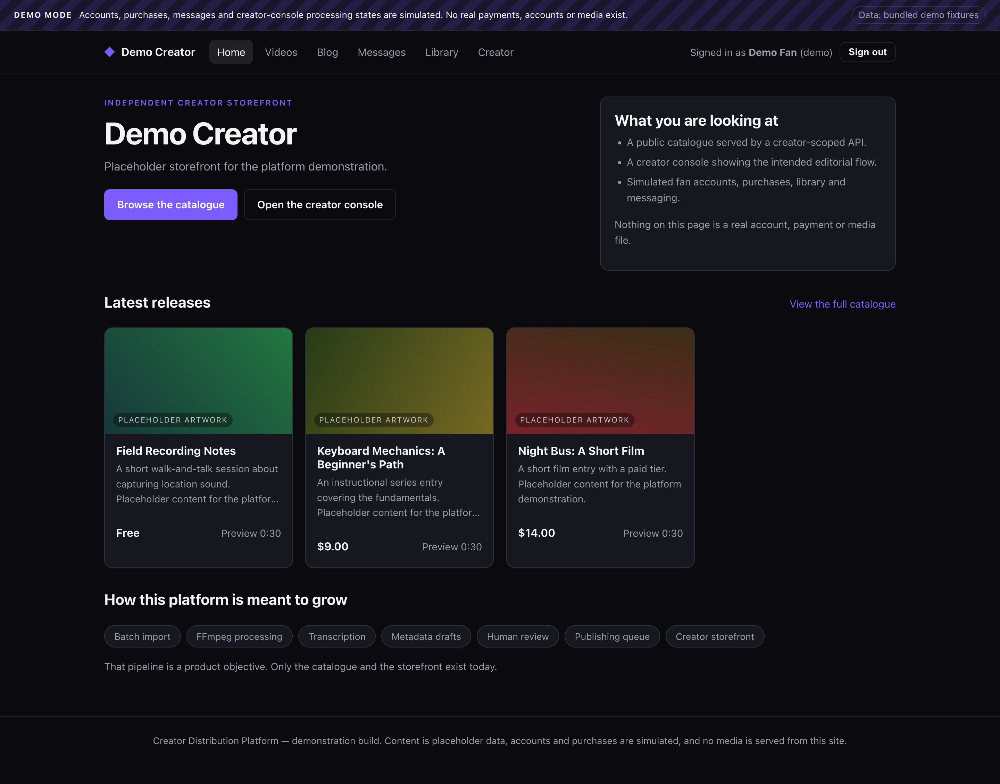

# Creator Distribution Platform

Shared backend infrastructure for independent creators, with a creator-specific
storefront on the creator's own domain. One catalogue service, many
storefronts.

> **Status · Non-production creator platform demo (CDP-002).** The catalogue,
> draft preview attachment and approved sample playback work against PostgreSQL.
> Fan sign-in, checkout, messages and console workflows are simulations.
> Fan authentication, creator accounts and roles, payments, media ingestion and
> publishing are unimplemented. The local operator capability is real.


---

## What this repository contains



| Part | Path | State |
| --- | --- | --- |
| Public, creator-scoped catalog API | `api/app/` | **Working.** Reads real rows from PostgreSQL. |
| Versioned database migrations | `api/alembic/` | **Working.** Applied by `alembic upgrade head`. |
| PostgreSQL + pgvector local stack | `docker-compose.yml` | **Working.** pgvector is installed by the migration. |
| Storefront SPA | `web/` | **Working.** Runs standalone with no backend. |
| Creator console | `web/src/pages/admin/` | **Local preview editor** saves draft attachments in PostgreSQL. Other inventory controls use sample data. |
| Simulated fan login, purchase, library, messaging | `web/src/pages/` | **Simulated.** No accounts, no payments, no messages sent. |
| Architecture decision record | `docs/architecture/adr/0001-platform-foundation.md` | **Written.** Describes the real boundaries. |

### Working vs simulated

**Working for real:** the catalog API, creator scoping, publication-state
filtering, the migrations, the pgvector column, the demo seed, the storefront
navigation, the catalogue filters, the theme system, and the production
frontend build.

**Simulated:** the fan sign-in, the purchase flow, the library, the messaging
inbox, every creator-console figure, the upload interaction, and the
editorial status transitions. Each one is marked as simulated *at the point
of use*, and a persistent banner names the active data mode on every route.

**Not implemented at all:** user authentication, payment processing, video upload,
transcoding, transcription, caption generation, embedding generation,
scheduled publishing, blog publishing, email, and third-party distribution
integrations. Each of these needs its own bounded task spec.

---

## Repository layout

```
RainSpace/
├── api/
│   ├── app/
│   │   ├── api/            # HTTP routers: health, creator-scoped catalog
│   │   ├── db/             # engine, session, declarative base, constants
│   │   ├── models/         # Creator, ContentItem, MediaAsset, Transcript
│   │   ├── schemas/        # public response contracts
│   │   ├── config.py       # environment-driven settings
│   │   ├── main.py         # FastAPI application
│   │   └── seed_demo.py    # repeatable, idempotent demo seed
│   ├── alembic/            # migrations (0001_initial_catalog) + alembic.ini
│   ├── tests/              # API tests: tenant scoping, visibility, payload
│   ├── Dockerfile
│   └── pyproject.toml      # pinned dependencies + test configuration
├── web/
│   ├── src/
│   │   ├── components/     # layout, cards, chips, notices, artwork
│   │   ├── data/           # DataSource boundary: fixtures | api
│   │   ├── hooks/          # useCatalogData
│   │   ├── pages/          # storefront + creator console routes
│   │   ├── state/          # creator context, simulated demo session
│   │   └── styles.css
│   ├── e2e/                # Playwright browser verification
│   └── package.json
├── docs/architecture/adr/0001-platform-foundation.md
├── docker-compose.yml
├── netlify.toml
└── .env.example
```

---

## Prerequisites

- Docker with Compose v2 (`docker compose`)
- Node.js 20.19+ or 22.12+ (Node 22 recommended; the project is built and
  tested on Node 22)
- npm 10+
- Python is **not** required on the host: the API runs in a container

---

## Quick start

### 1. Backend

```bash
git clone git@github.com:Resonant-Jones/RainSpace.git
cd RainSpace

cp .env.example .env          # optional: defaults already work locally

docker compose up -d --build db api
docker compose exec -T api alembic upgrade head
docker compose exec -T api python -m app.seed_demo
```

The API is then on <http://localhost:8000> and the database on
`localhost:5432`.

```bash
curl -fsS http://localhost:8000/health
curl -fsS http://localhost:8000/api/creators/demo/catalog
```

To run the API directly on the host instead of in a container, install the
pinned dependencies into a virtualenv and point `DATABASE_URL` at a running
PostgreSQL with pgvector:

```bash
cd api
python3.12 -m venv .venv && source .venv/bin/activate
pip install ".[dev]"
alembic upgrade head
uvicorn app.main:app --reload
```

### 2. Frontend

```bash
cd web
npm ci
npm run dev          # http://localhost:5173
```

The storefront works with **no backend running**. It ships with bundled
sample fixtures by default. This version names the storefront **Demo Creator**
and contains three illustrative published records, cover artwork and a sample
console. The API seed names the fictional studio **Rainspace Editions** and
installs three published releases, one draft, one scheduled item and a reviewed
18-second film teaser shared by the film and listening study. Fixtures give a
client a browsable offline tour. Live playback and persistent attachment editing
require the API. Browser-local fan actions remain simulated in both modes.

### 3. Point the frontend at the live API (optional)

```bash
VITE_DATA_MODE=api VITE_API_BASE_URL=http://localhost:8000 npm run dev
```

In `api` mode the catalogue is read from FastAPI. If the API is unreachable,
the interface shows an explicit error — it never falls back to sample data
or pretends that an empty catalogue is a successful response.

---

## Attach a public preview to a draft

In the local API-backed storefront, open **Creator → Content → Draft release preview**
(or go directly to `/admin/content#draft-previews`). Select a database draft and
an approved sample, then choose **Attach preview**. Reload to read the attachment
from PostgreSQL. Select **No preview → Remove preview** to detach it. A save only
changes the attachment on the selected draft. The sample inventory below the
editor runs separately.

On a fresh checkout, enable the local editor once from the repo root. This adds
a random operator capability to the ignored root `.env`. Keep the same value
across restarts. Rotate it by replacing that entry and restarting both services.

```sh
(umask 077; touch .env; chmod 600 .env; rg -q '^DRAFT_PREVIEW_TOKEN=' .env || python3 -c 'import secrets; print("\nDRAFT_PREVIEW_TOKEN=" + secrets.token_hex(32))' >> .env)
docker compose up -d --wait db
docker compose build api
docker compose run --rm --no-deps api alembic upgrade head
docker compose up -d --no-deps api
```

Start Vite in API mode as above. The local dev server reads the root `API_PORT`
and adds the capability to same-origin studio requests from the loopback
interface. The browser bundle contains no operator secret. The API checks the
capability, development environment, configured creator, draft status and
approved preview ID. A stale edit returns a conflict and can be reloaded.
People and processes with control of the local operator’s machine are trusted.
Keep the dev server on loopback and outside tunnels and reverse proxies.
Static builds provide the storefront and sample console.

Reviewed bytes and their SHA-256 registry live under `api/app/api/derivatives/`.
Only the API image includes the MP4. A creator must own an unprotected MP4
preview source with the reviewed digest. Attaching selects the sample for that
release. Publishing remains an out-of-band operator action. An eligible
published release's metadata and byte path are checked on every request.

**Withdraw the teaser for this creator.** From the repository root, a trusted
operator can run this transaction against the pilot database. Change the
creator slug deliberately if using a differently named seed. The returned count
and IDs describe the affected sources. A repeat after withdrawal updates zero rows.

```sh
docker compose exec -T db sh -c 'psql -v ON_ERROR_STOP=1 -U "$POSTGRES_USER" -d "$POSTGRES_DB"' <<'SQL'
UPDATE media_assets AS a SET is_protected = true
FROM content_items AS i JOIN creators AS c ON c.id = i.creator_id
WHERE a.content_item_id = i.id AND c.slug = 'demo'
  AND a.asset_type = 'preview' AND a.is_protected = false
  AND a.checksum_sha256 = '94e44e7661af0180c654859fe8bebd8caf09865c12c241e354047f33f4dec7a1'
RETURNING a.id;
SQL
```

A committed withdrawal stops new metadata and byte reads, including direct and
Range requests, without restarting a service. Existing downloads, in-flight
streams and previously shared static builds remain outside its reach. The teaser
is also in this public repository’s Git history. That independent copy remains
downloadable after platform withdrawal. Only publicity-cleared material belongs here. Reseeding
preserves withdrawals. Removing an attachment in the console affects only its
draft. Review source rights again before explicitly restoring a protected grant.

## Validation

Run these from the repository root.

```bash
# Inspect the working tree
git status --short --branch --untracked-files=all

# Frontend
npm ci --prefix web
npm run lint --prefix web
npm run test --prefix web -- --run
npm run build --prefix web

# Backend infrastructure
docker compose up -d --build db api
docker compose exec -T api alembic upgrade head
docker compose exec -T api python -m app.seed_demo

# Backend tests
docker compose exec -T api pytest -q

# HTTP checks
curl -fsS http://localhost:8000/health
curl -fsS http://localhost:8000/api/creators/demo/catalog

# Browser verification (installs are required once)
npx playwright install chromium
npm run test:e2e --prefix web

# Diff hygiene
git diff --check
```

The Playwright suite covers the fixture production build and a separate
API-mode production build served on loopback. Start the migrated Compose stack
first. The latter suite creates a throwaway schema and API container, drives
the real studio proxy and player, and removes the test resources. Its operator
transitions run directly in the disposable database. If the
browser binaries cannot be downloaded in your environment, `npm run test:e2e`
fails with the browser-install error; that is an environment failure, and a
successful `npm run build` is **not** a substitute for it.

Two optional switches help on unusual hosts:

```bash
# Run a different engine (chromium by default).
PW_BROWSER=firefox npm run test:e2e --prefix web
PW_BROWSER=chromium,firefox npm run test:e2e --prefix web

# Restricted sandboxes can block Chromium's Mach port bootstrap, which stops
# the browser at startup. Single-process mode avoids that path, at the cost
# of a browser that exits when its last page closes (tests then need a retry).
PW_CHROMIUM_ARGS="--single-process --no-zygote" npm run test:e2e --prefix web
```

### What the backend tests cover

`api/tests/` runs against a real PostgreSQL database with pgvector, inside a
throwaway schema created by running the real migrations. The suite proves:

- an unknown creator returns `404`;
- the catalogue contains **only** `published` content (drafts, scheduled and
  archived items are excluded);
- one creator's catalogue never contains another creator's content;
- a content slug belonging to another creator returns `404`;
- a draft or scheduled item returns `404` (identical to "does not exist", so
  drafts are not disclosed);
- the public payload contains no storage object key, no `is_protected` flag,
  no transcript text and no embedding, and never describes the `full` asset;
- published content is ordered newest first.

---

## API reference

The catalogue endpoints below are public and read-only. The local studio uses a separate creator-scoped capability.

| Method | Path | Behaviour |
| --- | --- | --- |
| `GET` | `/health` | `200` with service, version, environment and database reachability. |
| `GET` | `/api/creators/{creator_slug}` | Public storefront profile: slug, display name, tagline, theme, created timestamp. `404` if unknown. |
| `GET` | `/api/creators/{creator_slug}/catalog` | Published content for that creator only, newest first. `404` if the creator is unknown. |
| `GET` | `/api/creators/{creator_slug}/catalog/{content_slug}` | One published item. `404` for unknown creators, unknown content, and unpublished content. |

The catalogue also serves `GET /api/creators/{creator_slug}/catalog/{content_slug}/preview`
for an approved public sample on a published release. Its returned path ends in
`/preview/bytes` and supports MP4 range requests. The local studio lists drafts
with `GET /api/creators/{creator_slug}/studio/draft-previews` and saves an attachment
with `PUT` on that path followed by the draft slug. A studio `GET` on that same
draft path auditions the saved sample with the same operator capability.

Interactive docs: <http://localhost:8000/docs>.

### Data model

| Table | Key columns | Notes |
| --- | --- | --- |
| `creators` | `id` (uuid), `slug` (unique), `display_name`, `theme` (jsonb), `created_at` | One storefront owner. |
| `content_items` | `id`, `creator_id` (FK, cascade), `slug`, `title`, `description`, `price_minor_units`, `currency`, `status`, `published_at` | `UNIQUE (creator_id, slug)`; indexed on `(creator_id, status)`. |
| `media_assets` | `id`, `content_item_id` (FK, cascade), `asset_type`, `storage_object_key` (unique), `mime_type`, `duration_seconds`, `checksum_sha256`, `is_protected` | The storage key is never exposed publicly. |
| `transcripts` | `id`, `content_item_id` (FK, cascade, unique), `raw_text`, `summary`, `embedding` (`vector(512)`, nullable) | The embedding column exists so the retrieval contract is fixed; **no embeddings are generated in this task**. |

`vector(512)` is an initial implementation choice, not a platform-wide model
contract. Changing it later is a migration that alters the column type and
rebuilds any vector index.

### Frontend routes

| Route | Purpose |
| --- | --- |
| `/` | Creator landing page. |
| `/videos` | Catalogue with working search, price filter and sort. |
| `/videos/:slug` | Content detail with the simulated purchase flow. |
| `/blog` | Creator updates (sample posts). |
| `/messages` | Fan messaging demonstration. |
| `/login` | Simulated sign-in — display name only, no password field. |
| `/library` | Purchased-content demonstration. |
| `/admin` | Creator overview: inventory counts, sample earnings, processing states. |
| `/admin/content` | Content management and the editorial flow demonstration. |
| `/admin/schedule` | Weekly publishing calendar demonstration. |

---

## Configuration

Copy `.env.example` to `.env`. Every value has a working local default.

| Variable | Used by | Meaning |
| --- | --- | --- |
| `DATABASE_URL` | API, Alembic | SQLAlchemy URL. |
| `POSTGRES_USER` / `POSTGRES_PASSWORD` / `POSTGRES_DB` / `POSTGRES_PORT` | Compose | Local database credentials. |
| `APP_ENV` | API | Environment label reported by `/health`. |
| `CORS_ORIGINS` | API | Comma-separated browser origins allowed to call the API. List **every** origin you might type in the address bar: `localhost` and `127.0.0.1` are different origins to a browser, and a mismatch fails the request as "Failed to fetch" rather than as a clear CORS message. |
| `DEMO_CREATOR_SLUG` | API | Creator slug created by the demo seed. |
| `VITE_DATA_MODE` | Frontend build | `fixtures` (default) or `api`. |
| `VITE_API_BASE_URL` | Frontend build | Public base URL of the API, used only in `api` mode. |
| `VITE_CREATOR_SLUG` | Frontend build | Creator whose storefront is rendered. |

`VITE_*` variables are **inlined into the browser bundle**. Never put a
secret in one.

---

## Deployment (Netlify)

The frontend is a Vite SPA configured by `netlify.toml`: base `web`, build
`npm run build`, publish `dist` (Netlify resolves every path relative to the
base directory, so `dist` under base `web` means `web/dist`), and an SPA
fallback that serves `index.html` for direct navigation to a client route.

The default Netlify build uses **fixtures**. It includes public cover art and
sample records. It omits the teaser bytes and the local editor. For a client
tour, build the demo and create a draft deployment in an authorised demo project.

```sh
npm ci --prefix web
npm run build --prefix web
netlify deploy --dir=web/dist
```

Share the draft URL returned by Netlify. For a guided demo with live playback
and draft attachment, run the local API-backed studio and share your screen.
A hosted API-mode storefront would need an authorised, reachable HTTPS API,
`VITE_DATA_MODE=api`, its public `VITE_API_BASE_URL`, and its exact storefront
origin in the API's `CORS_ORIGINS`. A client's browser cannot use your loopback
address. Keep the operator capability and studio off the public network.
CDP-002 validates the build locally. See the [validation record](docs/tasks/CDP-002/closeout.md)
and [Netlify's draft deployment instructions](https://docs.netlify.com/api-and-cli-guides/cli-guides/get-started-with-cli/).

---

## Known limitations

1. **No fan authentication.** The public catalogue is readable by anyone. The
   public query scopes every release to its owning creator. The local studio
   uses a separate capability for draft preview attachments.
2. **No payment integration.** No processor is configured, deliberately. See
   the note below.
3. **No media pipeline.** No upload, no FFmpeg, no transcoding, no
   transcription, no caption or metadata generation, no embedding generation.
   The storage and retrieval columns exist so the contract is fixed; nothing
   populates them yet.
4. **No publisher or scheduler.** Publication state is a column value. The
   console demonstrates the editorial flow and its approval gate; it does not
   schedule or publish anything.
5. **Creator console persistence.** Draft preview attachments persist in PostgreSQL. Other console edits use local component state.
6. **No observability, no rate limiting, no backup procedure.** The health
   endpoint reports liveness only.
7. **The embedding dimension (512) is provisional.**
8. **One creator is seeded.** The schema is multi-creator; the demo data is
   not.

### Payments and hosting eligibility

Two external policies constrain the next payment task, and both are why this
foundation integrates nothing:

- **Stripe** lists *content creation platforms* — platforms that host or
  distribute third-party content and let creators take payments — as a
  restricted business requiring additional due diligence, and lists adult
  content and adult services as prohibited. Payment eligibility must be
  verified before any real transaction is enabled, and it may be impossible
  for a given creator. No processor is treated as the default here.
- **Netlify's Acceptable Use Policy** forbids using Netlify services for
  general-purpose file storage or media distribution unrelated to a site, and
  forbids collecting or processing payment card data on Netlify Forms,
  Functions, Blobs, the database or logs. Card data must be collected by a
  PCI DSS-compliant provider through a hosted page, iframe, redirect or
  client-side tokenisation.

Media privacy follows the same rule: originals are marked protected and are
only ever meant to be served through an authorised, signed path. No original
or paid media is exposed through public frontend assets or unprotected static
URLs — the demo serves approved public promotional samples.

---

## Architecture

The [approved-preview decision](docs/architecture/adr/0002-approved-preview-capability.md) covers the local capability and media withdrawal.

The reasoning behind the foundation choices — creator scoping, the data boundary, the
demo/real separation, and the seams for media processing, object storage,
payments, authentication and scheduling — is recorded in
[`docs/architecture/adr/0001-platform-foundation.md`](docs/architecture/adr/0001-platform-foundation.md).

**Architecture review is required before this foundation is treated as a
production contract.**
